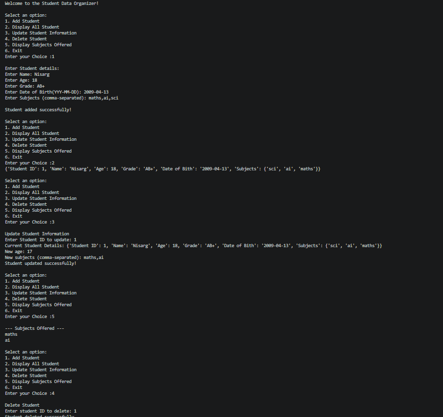
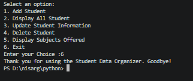

# Student Data Organizer

The Student Data Organizer is a simple Python project for managing student records. It allows users to add new students, display all student details, update existing information, and delete student records. The program also collects and displays the subjects offered by the students through a menu-driven interface.

## Output

